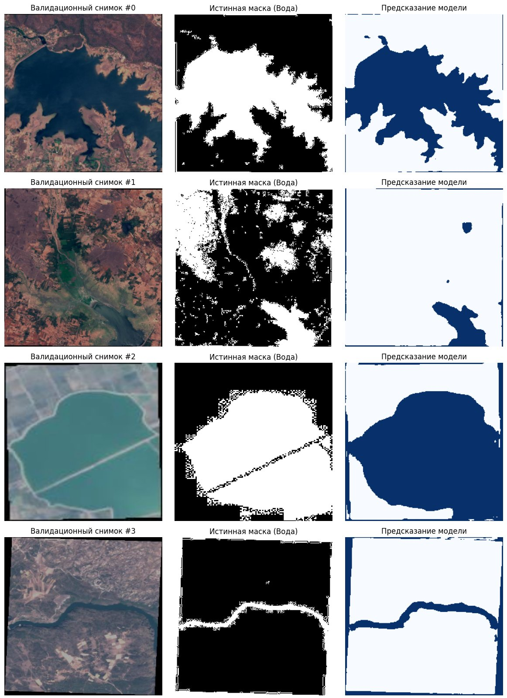

# Сегментация водных объектов на спутниковых снимках (U-Net)

Выпускная работа в рамках программы профессиональной переподготовки НГУ «Машинное обучение и нейронные сети». По спутниковому снимку модель определяет, какие пиксели относятся к воде.

*Слева снимок, в центре разметка из датасета (после бинаризации в ноутбуке), справа предсказание модели после последней, 20-й эпохи.*

## Данные

[Satellite Images of Water Bodies](https://www.kaggle.com/datasets/franciscoescobar/satellite-images-of-water-bodies) с Kaggle — 2841 снимок Sentinel-2 и к каждому чёрно-белая маска воды. Маски сделаны не вручную, а автоматически по водному индексу (NDWI), и хранятся в JPEG. Разбил случайно на обучение (2272) и валидацию (569).

## Что сделал

- **Модель:** U-Net с энкодером ResNet34, предобученным на ImageNet (библиотека segmentation-models-pytorch). Предобученный энкодер взял, потому что снимков всего 2,8 тысячи — с нуля сети было бы мало данных.
- **Функция потерь:** сумма Dice и BCE. Dice помогает, когда воды на снимке мало, а BCE делает обучение стабильнее.
- **Аугментации** (Albumentations): отражения и повороты на 90°, чтобы модель не запоминала конкретные снимки. Все снимки приводятся к 256×256 и нормализуются как для ImageNet.
- **Обучение:** Adam, lr 1e-4, 20 эпох, ReduceLROnPlateau — шаг уменьшается в 2 раза, если loss на валидации 2 эпохи не падает. Сохранял веса с лучшим IoU на валидации.
- Свои функции для метрик: IoU, Dice и точность по пикселям.

## Результаты

Лучший результат на валидации (18-я эпоха): **IoU 0.735, Dice 0.846**, точность по пикселям 0.888. Метрики посчитаны по каждому батчу и усреднены.

Что заметил:
- На масках после бинаризации видны «шахматные» артефакты и рамки по краям снимка. Скорее всего, их добавил я сам: в коде водой считается любой ненулевой пиксель маски (`mask > 0`), а маски хранятся в JPEG, и шум от сжатия вокруг границ тоже становится «водой». В следующий раз взял бы порог 127. Плюс маски изначально автоматические, поэтому местами неточные. Предсказания модели часто выглядят аккуратнее таких масок, так что часть «ошибки» по IoU — это шум в разметке.
- Отдельной тестовой выборки не было, лучшая эпоха выбиралась по той же валидации, поэтому оценка может быть немного завышенной. В следующий раз выделил бы ещё и тест.

## Как запустить

1. Открыть `water_segmentation_unet.ipynb` в Google Colab с GPU.
2. Положить архив датасета на Google Drive в `MyDrive/datasets/Satellite Images of Water Bodies.zip`.
3. Запустить ячейки по порядку.

## Стек

Python, PyTorch, segmentation-models-pytorch, Albumentations, Google Colab
