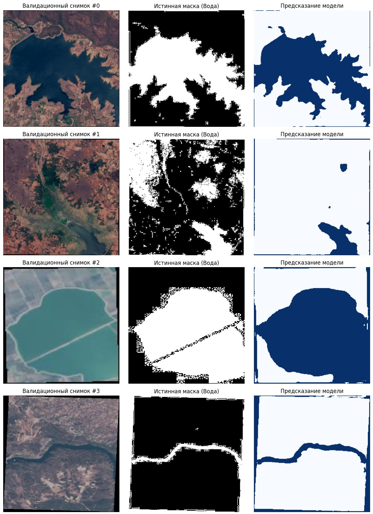

# Сегментация водных объектов на спутниковых снимках (U-Net)

Это моя выпускная работа на программе профессиональной переподготовки НГУ "Машинное обучение и нейронные сети". Задача - по спутниковому снимку определить, какие пиксели относятся к воде.

*Слева снимок, в центре разметка из датасета (после бинаризации в ноутбуке), справа предсказание модели после последней, 20-й эпохи.*

Датасет [Satellite Images of Water Bodies](https://www.kaggle.com/datasets/franciscoescobar/satellite-images-of-water-bodies) с Kaggle, там 2841 снимок со спутника Sentinel-2, и к каждому есть чёрно-белая маска воды. Маски сделаны не вручную, а автоматически по водному индексу (NDWI), и хранятся в JPEG. Разбил данные случайно на обучение (2272) и валидацию (569).

Снимков всего 2,8 тысячи, обучать сеть с нуля на таком количестве было бы тяжело, поэтому взял U-Net с энкодером ResNet34, предобученным на ImageNet (библиотека segmentation-models-pytorch). В качестве функции потерь использовал сумму Dice и BCE: Dice помогает, когда воды на снимке совсем мало, а BCE делает обучение стабильнее. Добавил аугментации через Albumentations в виде отражений и поворотов на 90°, чтобы модель не запоминала конкретные снимки, все снимки приводятся к 256×256 и нормализуются как для ImageNet. Обучал 20 эпох с Adam (lr 1e-4) и ReduceLROnPlateau, то есть шаг уменьшался в 2 раза, если loss на валидации 2 эпохи не падал, и сохранял веса с лучшим IoU на валидации. Функции для метрик (IoU, Dice и точность по пикселям) писал сам.

Лучший результат на валидации был на 18-й эпохе: IoU 0.735, Dice 0.846 и точность по пикселям 0.888. Метрики считались по каждому батчу и потом усреднялись.

Когда смотрел на предсказания, заметил на масках "шахматные" артефакты и рамки по краям снимков. Потом разобрался, откуда они: маски в датасете хранятся в JPEG, а в коде я считал водой любой ненулевой пиксель (`mask > 0`), поэтому шум от сжатия вокруг границ тоже становился "водой". В следующий раз взял бы порог посередине, 127. К тому же сами маски автоматические и местами неточные, поэтому модель часто выделяет воду аккуратнее, чем маска, и часть "ошибки" по IoU это шум в разметке. Из минусов ещё то, что отдельной тестовой выборки у меня не было, лучшая эпоха выбиралась по той же валидации, поэтому оценка может быть немного завышенной. В следующий раз обязательно выделил бы ещё и тест.

**Как запустить:** открыть `water_segmentation_unet.ipynb` в Google Colab с GPU, положить архив датасета на Google Drive в `MyDrive/datasets/Satellite Images of Water Bodies.zip` и запустить ячейки по порядку.

**Стек:** Python, PyTorch, segmentation-models-pytorch, Albumentations, Google Colab
